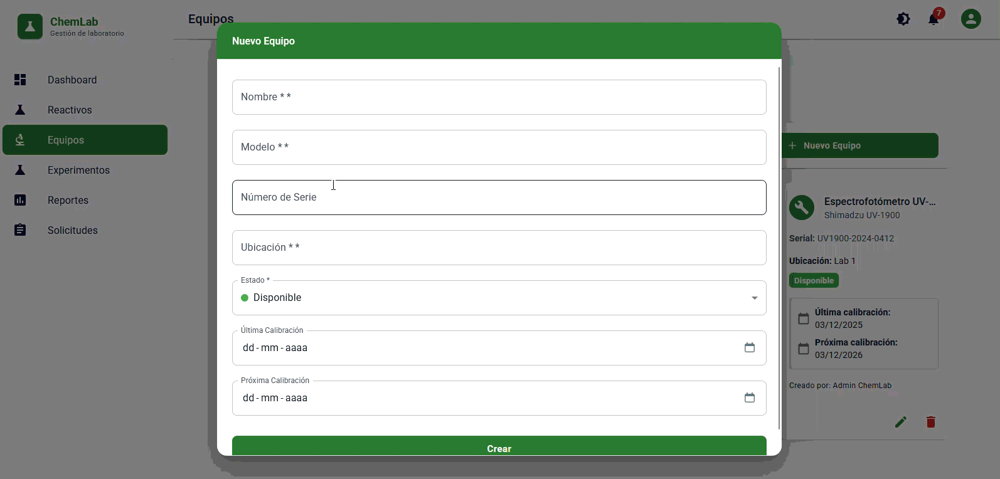
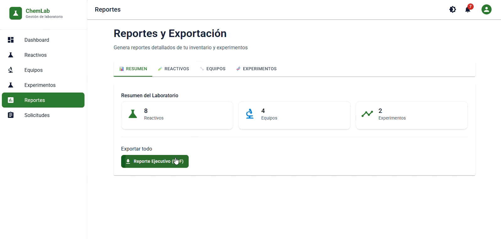

# 🧪 ChemLab — Gestión de inventario para laboratorios químicos

## 🌐 Demo en producción

| Componente | URL | Estado |
| --- | --- | :---: |
| **Frontend** | [chemlab-theta.vercel.app](https://chemlab-theta.vercel.app) | ✅ |
| **Backend API** | [chemlab-vozz.onrender.com](https://chemlab-vozz.onrender.com) | ✅ |
| **Swagger** | [/swagger](https://chemlab-vozz.onrender.com/swagger) | ✅ |
| **Health check** | [/api/health](https://chemlab-vozz.onrender.com/api/health) | ✅ |

### Credenciales demo

| Rol | Email | Password |
| --- | --- | --- |
| ADMIN | `admin@chemlab.com` | `Admin123!` |
| RESEARCHER | `demo@chemlab.com` | `Demo123!` |

> ⚠️ **Free tier**: Render duerme el backend tras 15 min de inactividad. El primer request tarda ~30 s.

---

## 🖼️ Capturas

### Login - Notificaciones - Reactivos - Equipos

### Equipos - Experimentos - Reportes

### Reportes y Exportación

### Solicitudes - Búsqueda de Reactivos en PubChem

---

## 📌 Estado del proyecto: v1.1.1

**Release actual.** Backend .NET 8 + EF Core + PostgreSQL (prod) / SQLite (dev) y frontend React + TypeScript + MUI, desplegados en Render + Vercel + Supabase. Seed demo incluido.

### Checklist de features

| Módulo | Estado | Detalle |
| --- | :---: | --- |
| Autenticación y sesión | ✅ | ASP.NET Identity + cookies, registro/login/logout, sesión cross-origin |
| Roles y permisos | ✅ | `ADMIN`, `LAB_MANAGER`, `RESEARCHER`, `LAB_TECH` |
| Reactivos | ✅ | CRUD, stock mínimo, GHS, vencimiento, autocompletado PubChem |
| Equipos | ✅ | CRUD, calibraciones, estados con colores |
| Experimentos | ✅ | Reactivos/equipos asociados, descuento de stock, estados, protocolo |
| Solicitudes | ✅ | Pendiente/aprobada/rechazada, prioridades, ítems |
| Notificaciones | ✅ | SignalR + persistencia + `NotificationBackgroundService` |
| Reportes | ✅ | Dashboard con gráficos, exportación Excel y PDF |
| Trazabilidad | ✅ | `/api/traceability/history/{entityType}/{entityId}` |
| Auditoría automática | ✅ | `AuditMiddleware` registra CREATE/UPDATE/DELETE en `AuditLogs` |
| Gestión de usuarios | ✅ | `/api/users` con policy `AdminOnly` |
| Seed demo | ✅ | 8 reactivos, 4 equipos, 2 experimentos, 2 solicitudes, 2 usuarios |
| Despliegue productivo | ✅ | Render (backend) + Vercel (frontend) + Supabase (PostgreSQL) |
| Cobertura de pruebas | ⏳ | Proyectos creados; cobertura aún no medida |

---

## 🎯 Problema y solución

Los laboratorios químicos pierden control cuando el stock está desactualizado, la trazabilidad no existe, los datos químicos se cargan a mano y las solicitudes internas circulan por correo. ChemLab concentra esos cuatro problemas:

- Alertas automáticas de stock bajo, calibraciones y vencimientos.
- Historial de cambios por entidad y auditoría automática de escrituras.
- Autocompletado de datos químicos desde PubChem (fórmula, peso molecular, CAS, InChI Key).
- Solicitudes con flujo de aprobación, prioridad y trazabilidad.

---

## ✨ Características

### 🧪 Reactivos
CRUD completo, control de stock con mínimo configurable, clasificación GHS, fecha de vencimiento, ubicación, proveedor e integración con PubChem.

### 🔧 Equipos
CRUD con estado (disponible, en uso, mantenimiento, calibración pendiente, fuera de servicio) y seguimiento de calibraciones.

### 🧬 Experimentos
Creación asociando reactivos (con cantidad y descuento de stock) y equipos, seguimiento de estado, protocolo y resultados.

### 📝 Solicitudes
Solicitudes de reactivos y equipos con prioridades (baja, media, alta, urgente) y flujo de aprobación/rechazo.

### 🔔 Notificaciones en tiempo real
Push vía SignalR, persistidas en base de datos, generadas por stock bajo, calibraciones próximas, reactivos por vencer y cambios de estado.

### 📊 Reportes
Dashboard con indicadores y gráficos, exportación a Excel (`xlsx` + `file-saver`) y PDF (`jspdf` + `jspdf-autotable`).

### 🔒 Seguridad, auditoría y trazabilidad
- Cookies de Identity (sin tokens en localStorage) y CORS con credenciales.
- `AuditMiddleware` escribe en `AuditLogs` cada POST/PUT/PATCH/DELETE exitoso.
- `/api/users` exige policy `AdminOnly`; no se puede degradar ni eliminar al último ADMIN activo.

---

## 👥 Roles y permisos

| Rol | Alcance |
| --- | --- |
| **ADMIN** | Acceso total, incluido `/admin/users` |
| **LAB_MANAGER** | Inventario, experimentos y reportes |
| **RESEARCHER** | Consulta de inventario y experimentos propios |
| **LAB_TECH** | Consulta de inventario, calibración de equipos |

---

## 🏗️ Arquitectura

Clean Architecture con dependencias hacia el dominio:

| Capa | Responsabilidad |
| --- | --- |
| `ChemLab.Domain` | Entidades (`Reagent`, `Equipment`, `Experiment`, `Request`, `Notification`, `AuditLog`, `User`) y enums |
| `ChemLab.Application` | DTOs y registro de MediatR/AutoMapper |
| `ChemLab.Infrastructure` | `ApplicationDbContext`, migraciones EF Core, DI de EF/Redis/SQLite/Npgsql |
| `ChemLab.API` | Minimal APIs, `AuditMiddleware`, SignalR, servicios de notificación |
| `frontend` | React + TypeScript (componentes, servicios, tipos, hooks) |

Endpoints y bases de datos:

- **Minimal APIs** organizadas por recurso en `ChemLabBackend/src/ChemLab.API/Endpoints/`.
- **SQLite** en desarrollo (ruta resuelta contra `ContentRoot`), **PostgreSQL** en producción (Supabase).
- **Identity** con `Guid` + `GuidToStringConverter`; roles leídos con SQL crudo sobre la misma conexión del `DbContext`.

Estructura del repositorio:

    ChemLab/
    ├── ChemLabBackend/
    │   ├── ChemLabInventory.slnx
    │   ├── src/
    │   │   ├── ChemLab.Domain/
    │   │   ├── ChemLab.Application/
    │   │   ├── ChemLab.Infrastructure/
    │   │   └── ChemLab.API/
    │   └── tests/
    ├── frontend/
    │   └── src/
    │       ├── components/
    │       ├── services/
    │       ├── types/
    │       ├── hooks/
    │       └── theme.ts
    ├── Dockerfile
    ├── render.yaml
    └── .gitignore

---

## 🚀 Tecnologías

**Backend:** .NET 8 · ASP.NET Core Minimal APIs · Entity Framework Core 8 · PostgreSQL (prod) / SQLite (dev) · ASP.NET Identity · SignalR · Swagger.

**Frontend:** React 18 · TypeScript 4.9 · MUI 5 · React Query · React Router 6 · React Hook Form + Zod · Recharts · date-fns (locale `es`) · xlsx / jsPDF.

**Infraestructura:** Render (backend free) · Vercel (frontend free) · Supabase (PostgreSQL free) · Docker.

**Externas:** [PubChem](https://pubchem.ncbi.nlm.nih.gov/) para datos químicos.

---

## 📦 Instalación local (verificada)

### Requisitos

- [.NET 8 SDK](https://dotnet.microsoft.com/download/dotnet/8.0)
- [Node.js 18+](https://nodejs.org/) y [pnpm](https://pnpm.io/) (`corepack enable`)
- Herramienta EF Core: `dotnet tool install --global dotnet-ef`

### Backend

    git clone https://github.com/criverap-duoc/ChemLab.git
    cd ChemLab/ChemLabBackend

    dotnet restore
    dotnet ef database update --project src/ChemLab.Infrastructure --startup-project src/ChemLab.API
    dotnet run --project src/ChemLab.API

La API queda en `http://localhost:5000` y Swagger en `http://localhost:5000/swagger`.

### Frontend

    cd frontend
    pnpm install --frozen-lockfile
    pnpm start

La aplicación queda en `http://localhost:3000`. El proyecto usa **solo pnpm**: el lockfile oficial es `pnpm-lock.yaml`.

### Primer arranque

1. Inicializar los roles de Identity:

       curl -X POST http://localhost:5000/api/setup/init-roles

2. Registrarse en `http://localhost:3000/register` (asigna `RESEARCHER`).

3. Promover el primer usuario a `ADMIN`:

       UPDATE AspNetUserRoles
          SET RoleId = (SELECT Id FROM AspNetRoles WHERE Name = 'ADMIN')
        WHERE UserId = (SELECT Id FROM AspNetUsers WHERE Email = 'tu@correo.cl');

4. A partir de ahí, la gestión de usuarios se hace desde `/admin/users` o con `/api/users`.

5. **Datos de ejemplo** (opcional, requiere ADMIN):

       curl -X POST http://localhost:5000/api/setup/seed-demo -b cookies.txt

> Comprobar la salud del backend: `GET http://localhost:5000/api/health` → `{ "status": "Healthy", "version": "1.0.0" }`.

---

## 🔌 API principal

| Método | Ruta | Auth | Descripción |
| --- | --- | --- | --- |
| `POST` | `/api/auth/register` | — | Alta de usuario (rol `RESEARCHER`) |
| `POST` | `/api/auth/login` | — | Login por cookie + rol real |
| `POST` | `/api/auth/logout` | Cookie | Cierre de sesión |
| `GET/POST/PUT/DELETE` | `/api/reagents` | Cookie | CRUD de reactivos |
| `GET/POST/PUT/DELETE` | `/api/equipment` | Cookie | CRUD de equipos |
| `GET/POST/PUT/DELETE` | `/api/experiments` | Cookie | Experimentos con reactivos y equipos |
| `GET/POST/PUT/DELETE` | `/api/requests` | Cookie | Solicitudes y flujo de aprobación |
| `GET` | `/api/notifications/unread` | Cookie | Notificaciones no leídas |
| `POST` | `/api/notifications/mark-read/{id}` | Cookie | Marcar una como leída |
| `POST` | `/api/notifications/mark-all-read` | Cookie | Marcar todas como leídas |
| `GET` | `/api/traceability/history/{entityType}/{entityId}` | Cookie | Historial de cambios |
| `GET` | `/api/users` | **ADMIN** | Listado paginado con rol |
| `PUT` | `/api/users/{id}/role` | **ADMIN** | Cambio de rol |
| `PUT` | `/api/users/{id}/status` | **ADMIN** | Activar / desactivar |
| `DELETE` | `/api/users/{id}` | **ADMIN** | Baja lógica |
| `POST` | `/api/setup/init-roles` | — | Crea los 4 roles |
| `POST` | `/api/setup/seed-demo` | **ADMIN** | Puebla con datos demo |
| `GET` | `/api/health` | — | Health check |
| `WS` | `/hubs/notifications` | Cookie | Hub SignalR |

---

## 🧪 Verificación y scripts

    # Backend: compilación completa (0 errores esperados)
    cd ChemLabBackend
    dotnet build ChemLabInventory.slnx

    # Migraciones: todas deben aparecer aplicadas (sin "(Pending)")
    dotnet ef migrations list --project src/ChemLab.Infrastructure --startup-project src/ChemLab.API

    # Frontend: tipos y build de producción
    cd ../frontend
    pnpm exec tsc --noEmit
    pnpm run build

Cierre v1.1.1: `dotnet build` → **0 advertencias, 0 errores**; `tsc --noEmit` → **0 errores**; `pnpm run build` → **Compiled successfully**; `dotnet ef migrations list` → **6/6 migraciones aplicadas**.

---

## 📋 Limitaciones conocidas (free tier)

- **Cold start**: Render duerme el backend tras 15 min de inactividad. El primer request tarda ~30 s.
- **Data Protection keys**: se regeneran en cada deploy/spin-down. Los usuarios deben re-loguearse después de cada reinicio.
- **SQLite** es la base de desarrollo; producción usa PostgreSQL (Supabase).
- **Roles**: se resuelven con SQL crudo porque `UserManager.GetRolesAsync()` devuelve vacío con `IdentityRole<Guid>` + `GuidToStringConverter` en este modelo.
- **`LastLogin`** no se persiste: la API devuelve `null` y la UI muestra "Nunca".
- **`AuditMiddleware`** audita los 4 recursos de inventario/experimentación; `/api/users` queda fuera en v1.1.1.

## 🔮 Roadmap

- CI/CD con GitHub Actions (build + tests + tag automático).
- Cobertura de pruebas en `ChemLab.Application.UnitTests` y `ChemLab.API.IntegrationTests`.
- Auditoría de `/api/users` y persistencia de `LastLogin`.
- Predicción de stock con ML.NET.

---

## 🤝 Contribuciones

1. Fork del proyecto.
2. Rama de trabajo desde `develop`: `git checkout -b feature/mi-aporte`.
3. Cambios con `pnpm` (nunca `npm` ni `yarn`) y build en verde.
4. Pull Request hacia `develop`.

---

## 📝 Licencia

Distribuido bajo licencia MIT.

## 📧 Contacto

Cristóbal Vera — [GitHub @criverap-duoc](https://github.com/criverap-duoc)

Repositorio: [https://github.com/criverap-duoc/ChemLab](https://github.com/criverap-duoc/ChemLab)